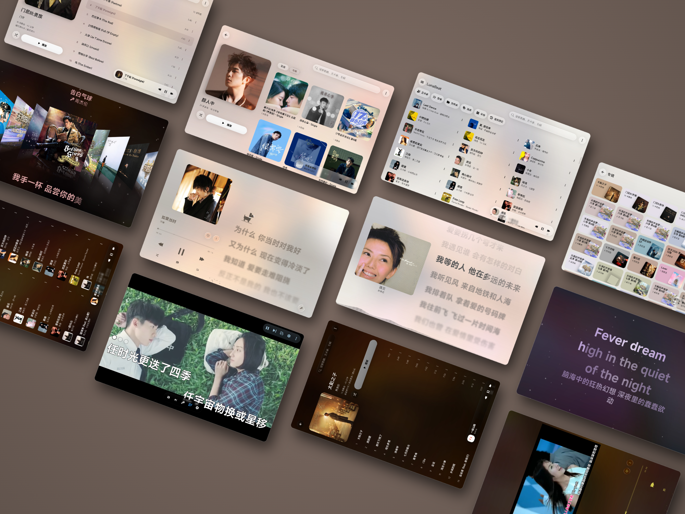

# LunaBeat

**Melodie und Liedtext begegnen sich bei jeder Wiedergabe.**

Lokaler Musikplayer für Android · Wortgenaue Liedtextbearbeitung · Musikbibliothek und Tag-Verwaltung

[Neueste Version herunterladen](https://github.com/2755337087/LunaBeat/releases/latest) · [Anleitung](#quick-start) · [Problem melden](https://github.com/2755337087/LunaBeat/issues) · [Community](#community-and-feedback)

[简体中文](https://github.com/2755337087/LunaBeat/blob/main/README.md) | [繁體中文](https://github.com/2755337087/LunaBeat/blob/main/README_ZH_TW.md) | [English](https://github.com/2755337087/LunaBeat/blob/main/README_EN.md) | [日本語](https://github.com/2755337087/LunaBeat/blob/main/README_JA.md) | [Türkçe](https://github.com/2755337087/LunaBeat/blob/main/README_TR.md) | [한국어](https://github.com/2755337087/LunaBeat/blob/main/README_KO.md) | [Русский](https://github.com/2755337087/LunaBeat/blob/main/README_RU.md) | [Bahasa Indonesia](https://github.com/2755337087/LunaBeat/blob/main/README_ID.md) | [Tiếng Việt](https://github.com/2755337087/LunaBeat/blob/main/README_VI.md) | [ไทย](https://github.com/2755337087/LunaBeat/blob/main/README_TH.md) | [Español](https://github.com/2755337087/LunaBeat/blob/main/README_ES.md) | [हिन्दी](https://github.com/2755337087/LunaBeat/blob/main/README_HI.md) | [Português](https://github.com/2755337087/LunaBeat/blob/main/README_PT.md) | [Français](https://github.com/2755337087/LunaBeat/blob/main/README_FR.md) | [Deutsch](https://github.com/2755337087/LunaBeat/blob/main/README_DE.md) | [العربية](https://github.com/2755337087/LunaBeat/blob/main/README_AR.md)

---

LunaBeat vereint die Wiedergabe lokaler Musik, die Erstellung wortgenauer Liedtexte und die Organisation der Musikbibliothek in einer App. Genieße Musik und verfolge den Text im Takt der Melodie, oder zerlege einen Liedtext in Wörter, lege deren Zeiten fest, ergänze Übersetzungen und Duettinformationen und exportiere das Ergebnis für deinen eigenen Liedtext-Workflow.

## Einblick in die Oberfläche

### Smartphone-Ansicht

  

### Tablet-Ansicht

  

## Hauptfunktionen

| Einsatzbereich | Möglichkeiten |
| --- | --- |
| Lokale Musik hören | Lokale Audiodateien scannen und nach Interpret, Album oder Playlist durchsuchen; Hintergrundwiedergabe, System-Mediensteuerung, Warteschlange und Abschalttimer nutzen. |
| Liedtexte erleben | Wortgenaue Liedtexte mit hellem oder dunklem Design sowie Einstellungen für Wiedergabeleiste und Hintergrund anzeigen; Liedtexte auf dem Startbildschirm, in der Statusleiste und über die Bluetooth-Verbindung im Auto ausgeben. |
| Wortgenaues Timing | Mit den drei Tasten Start / Weiter / Ende Zeiten setzen und sie mit Wiedergabegeschwindigkeit, Zeitsprüngen, Folgemodus, Rückgängig und Wiederholen verfeinern. |
| Liedtexte bearbeiten | Wörter segmentieren, Texte teilen und zusammenführen, Zeilen verschieben, Zeitstempel versetzen, zwischen vereinfachtem und traditionellem Chinesisch umwandeln, Leerzeilen entfernen sowie Übersetzungen, Duette und Begleitgesang einstellen. |
| Musik organisieren | Playlists, Favoriten und mit fünf Sternen bewertete Titel verwalten; Cover, Tags und Liedtexte gesammelt zuordnen, Metadaten bearbeiten und Dateien umbenennen. |

### Import und Export

| Inhalt | Import | Export |
| --- | --- | --- |
| Liedtexte als Klartext | Unterstützt | — |
| LRC (zeilenweise / wortweise) | Unterstützt | Unterstützt |
| Erweitertes LRC (ELRC) | Unterstützt | Unterstützt |
| TTML | Unterstützt | Unterstützt, einschließlich Duett- und Begleitgesangsinformationen |

Du kannst auch nach Liedtexten suchen oder Audiodateien importieren, um mit der Erstellung zu beginnen. TTML empfiehlt sich zum Erhalten von Strukturinformationen wie Duetten und Begleitgesang; LRC eignet sich für die normale Liedtextanzeige.

## Schnellstart

### Musik hören und die Bibliothek organisieren

1. Öffne die Musikbibliothek und scanne die lokalen Audiodateien auf deinem Gerät.
2. Suche nach Interpret, Album, Playlist oder Favoriten und tippe auf einen Titel, um ihn abzuspielen.
3. Öffne den vollständigen Player, um den Wiedergabemodus zu ändern, die Warteschlange zu verwalten, Liedtexte anzuzeigen oder einen Abschalttimer einzustellen.
4. Ordne zur Dateiorganisation zuerst Tags und Liedtexte gesammelt zu und bearbeite dann Tags oder Dateinamen.

### Wortgenaue Liedtexte für einen Titel erstellen

1. **Importieren**: Wähle eine Audiodatei und importiere anschließend Liedtexte als Klartext, LRC, ELRC oder TTML. Du kannst auch nach Liedtexten suchen.
2. **Vorbereiten**: Segmentiere zuerst die Wörter, entferne dann Leerzeilen, führe Text zusammen oder wandle zwischen vereinfachtem und traditionellem Chinesisch um. Vorhandene Zeiten kannst du zunächst durch eine Verschiebung der gesamten Zeitachse ausrichten.
3. **Zeiten setzen**: Spiele die Audiodatei ab und nutze die drei Tasten unten im Rhythmus einer Liedtextzeile.
4. **Verfeinern**: Tippe doppelt auf den Text, um zurückzuspringen und erneut zuzuhören. Prüfe die Zeiten mit Folgemodus, Rückgängig und Wiederholen; halte eine Einheit oder Zeile gedrückt, um sie zu teilen, zusammenzuführen, zu verschieben oder Übersetzungen zu bearbeiten.
5. **Vorschau und Export**: Prüfe den wortgenauen Effekt; wähle LRC für die normale Anzeige oder TTML für Duett- und Begleitgesangsinformationen.

| Taste | Aktion |
| --- | --- |
| Start | Setzt die Startzeit der aktuellen Einheit und bleibt bei dieser Einheit. |
| Weiter | Setzt die Endzeit der aktuellen Einheit, wechselt zur nächsten und setzt zugleich deren Startzeit. |
| Ende | Setzt die Endzeit der aktuellen Einheit und wechselt zur nächsten; deren Startzeit wird später festgelegt. |

Empfohlene Abfolge: `Start → Weiter → Weiter → … → Ende`, für jede Zeile wiederholen.

Tipps zum Setzen der Zeiten

- Die Zeit- und Textspalten zeigen Startzeit, Liedtext, Endzeit und Übersetzung.
- Tippe einmal auf eine Einheit, um sie auszuwählen, und doppelt, um zu ihrer Startzeit zu springen und erneut zuzuhören.
- Zurückspulen / Vorspulen, Wiedergabe / Pause, Geschwindigkeitsänderungen und Sprünge zu einer bestimmten Zeit werden unterstützt.
- Tippe auf die Wiedergabezeit, um den Folgemodus zu aktivieren; tippe auf die Zeit im Timing-Bereich, um ein eigenes Sprungziel festzulegen.
- Duette lassen sich als links (Hauptgesang), rechts (zweite Gesangsstimme) oder Hintergrund (Begleitgesang) einstellen und als TTML exportieren.

## Häufige Fragen

Soll ich LRC oder TTML wählen?

Wähle LRC für die normale Liedtextanzeige und TTML, wenn Strukturinformationen wie Duette und Begleitgesang erhalten bleiben sollen. Prüfe den wortgenauen Effekt vor dem Export in der Vorschau.

Was ist beim Exportieren und Abspielen von Duett-Liedtexten zu beachten?

Exportiere Duett- und Begleitgesangsinformationen vorzugsweise als TTML und verwende einen Player, der diese Effekte unterstützt. Die tatsächliche Anzeige hängt davon ab, wie der Player das Liedtextformat und dessen Informationen unterstützt.

Wie korrigiere ich Liedtexte, die insgesamt zu früh oder zu spät erscheinen?

Verschiebe zunächst die Zeitstempel, um die gesamte Zeitachse auszurichten, und verfeinere danach einzelne Stellen im Timing-Bildschirm.

Wo beginne ich, wenn ich zum ersten Mal Zeiten für Liedtexte setze?

Schließe zuerst die Wortsegmentierung und Textbereinigung ab. Wähle einen vertrauten Titel, nutze pro Zeile „Start → Weiter → … → Ende“ und höre anschließend noch einmal zu, um kleine Korrekturen vorzunehmen.

## Community und Feedback

- [GitHub Issues · Fehlerberichte und Funktionsvorschläge](https://github.com/2755337087/LunaBeat/issues)
- [Telegram · LunaBeat-Community-Gruppe](https://t.me/+qXs6mjKqwhw3Zjll)
- [QQ · LunaBeat-Community-Gruppe](https://qm.qq.com/q/N0fBvuWKOY) · Gruppennummer: **964680520**

Gib bei Problemen möglichst die App-Version, das Gerät und die Android-Version, Schritte zur Reproduktion sowie passende Screenshots oder Dateiformate an. Das erleichtert die Fehlersuche.

## Besonderer Dank

### Technische Unterstützung

- [TagLib](https://github.com/taglib/taglib)
- [Lyricon](https://github.com/tomakino/lyricon)
- [OpenCC](https://github.com/BYVoid/OpenCC)
- [any-listen-extension-online-metadata](https://github.com/any-listen/any-listen-extension-online-metadata)
- [163Music2Tag](https://gitee.com/Wangs-official/163Music2Tag)
- [TagLib(Kyant0)](https://github.com/Kyant0/taglib)
- [uCrop](https://github.com/Yalantis/uCrop)
- [accompanist-lyrics-ui](https://github.com/6xingyv/accompanist-lyrics-ui)
- [lottie-android](https://github.com/airbnb/lottie-android)
- [ICU Transliterator](https://unicode-org.github.io/icu/userguide/transforms/general/)
- [AndroidLiquidGlass](https://github.com/Kyant0/AndroidLiquidGlass)
- [AMLLTTML歌词站](https://amlldb.bikonoo.com/)
- [LunaBeat歌词站](https://github.com/2755337087/ttml-hub/blob/main/README.md)

### Inspiration

- [amll-ttml-tool](https://github.com/amll-dev/amll-ttml-tool)
- [音乐标签](https://www.cnblogs.com/vinlxc/p/11932130.html)
- [光锥音乐](https://coneplayer.trantor.ink/)
- [Halcyon](https://github.com/Kifranei/Halcyon)
- [Flamingo](https://github.com/Yos-X)
